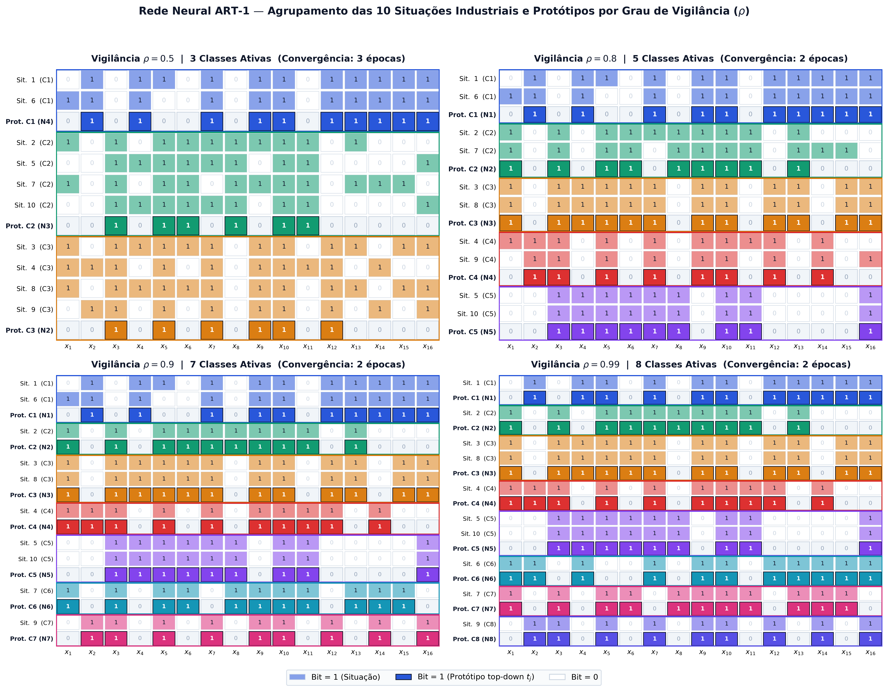
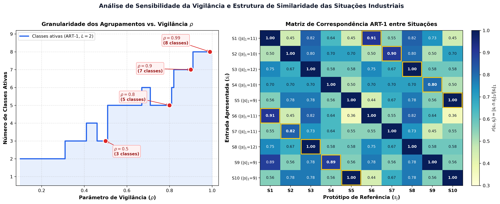

# Centro Federal de Educação Tecnológica de Minas Gerais (CEFET-MG)
## Campus VIII – Varginha | Bacharelado em Sistemas de Informação
**Disciplina:** Laboratório de Inteligência Artificial  
**Professor:** Lázaro Eduardo da Silva  
**Data:** 19/11/2026  
**Trabalho:** Rede Neural ART-1 (*Adaptive Resonance Theory 1*) Aplicada ao Agrupamento de Situações de um Processo Industrial

---

## 1. Visão Geral do Problema e Arquitetura da Rede ART-1

O comportamento de um processo industrial é monitorado por meio de **$n = 16$ variáveis binárias de status** ($x_1, x_2, \dots, x_{16} \in \{0, 1\}$), registradas em **10 situações** ([`data/treinamento.csv`](file:///home/alunos/Downloads/linn/ART/data/treinamento.csv)). O objetivo é implementar e treinar uma rede **ART-1** capaz de agrupar situações semelhantes em classes distintas, fornecendo subsídios para o diagnóstico e eventual manutenção do processo, avaliando os graus de vigilância $\rho \in \{0.5,\; 0.8,\; 0.9,\; 0.99\}$.

### 1.1. Parâmetros e Equações do Algoritmo ART-1

Adotou-se a formulação canônica da rede ART-1 com aprendizagem rápida (*fast learning*):

- **Camada de comparação ($F_1$):** $n = 16$ unidades correspondentes ao vetor binário de entrada $\mathbf{s} = [x_1, \dots, x_{16}]^T$.
- **Camada de reconhecimento ($F_2$):** $m = 10$ neurônios competitivos (número máximo de categorias necessárias para 10 amostras).
- **Constante de controle:** $L = 2$ (valor clássico da literatura).
- **Inicialização dos pesos sinápticos:**
  - Pesos *top-down* ($F_2 \to F_1$, protótipos/gabaritos):
    $$t_{ji}(0) = 1 \qquad \forall j \in \{1,\dots,m\},\; i \in \{1,\dots,n\}$$
  - Pesos *bottom-up* ($F_1 \to F_2$, seleção competitiva), satisfazendo $0 < b_{ij}(0) < \frac{L}{L - 1 + n} = \frac{2}{17}$:
    $$b_{ij}(0) = \frac{1}{1 + n} = \frac{1}{17} \approx 0.058824$$
- **Fase de competição ($F_2$):** Para cada neurônio não inibido $j$, calcula-se a ativação:
  $$y_j = \sum_{i=1}^{16} b_{ij}\,s_i$$
  selecionando o vencedor $J = \arg\max_j y_j$ (com desempate determinístico pelo menor índice $j$).
- **Teste de vigilância:** Calcula-se a interseção lógica (AND bit a bit) $\mathbf{x} = \mathbf{s} \cap \mathbf{t}_J$ e a razão de similaridade:
  $$r = \frac{\|\mathbf{s} \cap \mathbf{t}_J\|_1}{\|\mathbf{s}\|_1} = \frac{\sum_{i=1}^{16} s_i\,t_{Ji}}{\sum_{i=1}^{16} s_i}$$
  - Se $r < \rho$: ocorre **reset** — o neurônio $J$ é inibido para a situação atual e a busca continua entre os demais neurônios de $F_2$.
  - Se $r \ge \rho$: ocorre **ressonância** — a situação é associada à classe $J$ e os pesos do vencedor são atualizados:
    $$t_{Ji}^{\text{novo}} = s_i \cdot t_{Ji}^{\text{antigo}}, \qquad b_{iJ}^{\text{novo}} = \frac{L \cdot t_{Ji}^{\text{novo}}}{L - 1 + \sum_{k=1}^{16} t_{Jk}^{\text{novo}}}$$
- **Convergência:** As 10 situações são apresentadas em épocas sucessivas até que nenhuma situação altere sua classe e nenhum protótipo $\mathbf{t}_j$ sofra modificação.

> **Observação estrutural dos dados:** As **Situações 3 e 8** possuem vetores binários estritamente idênticos ($\|\mathbf{s}\|_1 = 12$), assim como as **Situações 5 e 10** ($\|\mathbf{s}\|_1 = 9$). Consequentemente, mesmo para $\rho \to 1$, o número máximo de classes ativas para esse conjunto de dados é **8**.

---

## 2. Resultados das Simulações por Grau de Vigilância ($\rho$)

Os resultados detalhados de todas as simulações foram gerados pelo script [`main.py`](file:///home/alunos/Downloads/linn/ART/main.py) e exportados em [`tabela_resumo_art1.csv`](file:///home/alunos/Downloads/linn/ART/tabela_resumo_art1.csv) e [`tabela_classificacao_art1.csv`](file:///home/alunos/Downloads/linn/ART/tabela_classificacao_art1.csv).

### 2.1. Quadro Comparativo Geral

| Vigilância ($\rho$) | Classes Ativas | Épocas até Convergência | Total de Resets | Agrupamentos Obtidos |
| :---: | :---: | :---: | :---: | :--- |
| **$0.50$** | **3** | 3 | 10 | **C1:** $\{1, 6\}$ \| **C2:** $\{2, 5, 7, 10\}$ \| **C3:** $\{3, 4, 8, 9\}$ |
| **$0.80$** | **5** | 2 | 10 | **C1:** $\{1, 6\}$ \| **C2:** $\{2, 7\}$ \| **C3:** $\{3, 8\}$ \| **C4:** $\{4, 9\}$ \| **C5:** $\{5, 10\}$ |
| **$0.90$** | **7** | 2 | 21 | **C1:** $\{1, 6\}$ \| **C2:** $\{2\}$ \| **C3:** $\{3, 8\}$ \| **C4:** $\{4\}$ \| **C5:** $\{5, 10\}$ \| **C6:** $\{7\}$ \| **C7:** $\{9\}$ |
| **$0.99$** | **8** | 2 | 28 | **C1:** $\{1\}$ \| **C2:** $\{2\}$ \| **C3:** $\{3, 8\}$ \| **C4:** $\{4\}$ \| **C5:** $\{5, 10\}$ \| **C6:** $\{6\}$ \| **C7:** $\{7\}$ \| **C8:** $\{9\}$ |

*(Verificação de robustez: para $L \in \{1.5,\; 2.0,\; 3.0,\; 5.0\}$, todas as 4 simulações produziram exatamente o mesmo número de classes ativas e os mesmos agrupamentos.)*

---

### 2.2. Simulação 1 — Vigilância $\rho = 0.5$

- **Número de classes ativas:** **3 classes** (convergência em 3 épocas; 10 resets no total).
- **Observação de convergência:** Durante a época 1, o neurônio $F_2 = 1$ recebeu as Situações 1 e 2 (reduzindo seu gabarito para apenas 5 bits ativos). Na época 2, a Situação 1 migrou para o neurônio $F_2 = 4$ (com $r = 10/11 = 0.9091$) e a Situação 2 migrou para o neurônio $F_2 = 3$ (com $r = 6/10 = 0.6000$), deixando o neurônio $F_2 = 1$ sem amostras associadas (inativo) e estabilizando a rede em 3 classes ativas.

| Classe Ativa | Neurônio $F_2$ | Situações Agrupadas | Protótipo *Top-Down* $\mathbf{t}_j$ ($x_1 \dots x_{16}$) | $\|\mathbf{t}_j\|_1$ | Similaridades $r = \|\mathbf{s}\cap\mathbf{t}_j\|_1 / \|\mathbf{s}\|_1$ |
| :---: | :---: | :---: | :---: | :---: | :--- |
| **Classe 1** | N4 | **$\{1,\; 6\}$** | `0101001011011111` | 10 | S1: $10/11 = 0.9091$ \| S6: $10/11 = 0.9091$ |
| **Classe 2** | N3 | **$\{2,\; 5,\; 7,\; 10\}$** | `0010110101100000` | 6 | S2: $6/10 = 0.6000$ \| S5: $6/9 = 0.6667$ \| S7: $6/11 = 0.5455$ \| S10: $6/9 = 0.6667$ |
| **Classe 3** | N2 | **$\{3,\; 4,\; 8,\; 9\}$** | `0010101011010000` | 6 | S3: $6/12 = 0.5000$ \| S4: $6/10 = 0.6000$ \| S8: $6/12 = 0.5000$ \| S9: $6/9 = 0.6667$ |

---

### 2.3. Simulação 2 — Vigilância $\rho = 0.8$

- **Número de classes ativas:** **5 classes** (convergência em 2 épocas; 10 resets no total).
- Com $\rho = 0.8$, a rede separa exatamente os **5 pares naturais** presentes na tabela industrial, mantendo alta coerência interna ($r \ge 0.80$ para todas as situações):

| Classe Ativa | Neurônio $F_2$ | Situações Agrupadas | Protótipo *Top-Down* $\mathbf{t}_j$ ($x_1 \dots x_{16}$) | $\|\mathbf{t}_j\|_1$ | Similaridades $r = \|\mathbf{s}\cap\mathbf{t}_j\|_1 / \|\mathbf{s}\|_1$ |
| :---: | :---: | :---: | :---: | :---: | :--- |
| **Classe 1** | N1 | **$\{1,\; 6\}$** | `0101001011011111` | 10 | S1: $10/11 = 0.9091$ \| S6: $10/11 = 0.9091$ |
| **Classe 2** | N2 | **$\{2,\; 7\}$** | `1010110111101000` | 9 | S2: $9/10 = 0.9000$ \| S7: $9/11 = 0.8182$ |
| **Classe 3** | N3 | **$\{3,\; 8\}$** | `1011111011011011` | 12 | S3: $12/12 = 1.0000$ \| S8: $12/12 = 1.0000$ |
| **Classe 4** | N4 | **$\{4,\; 9\}$** | `0110101011010100` | 8 | S4: $8/10 = 0.8000$ \| S9: $8/9 = 0.8889$ |
| **Classe 5** | N5 | **$\{5,\; 10\}$** | `0011111101100001` | 9 | S5: $9/9 = 1.0000$ \| S10: $9/9 = 1.0000$ |

---

### 2.4. Simulação 3 — Vigilância $\rho = 0.9$

- **Número de classes ativas:** **7 classes** (convergência em 2 épocas; 21 resets no total).
- Ao elevar o limiar para $\rho = 0.9$, os pares $\{2, 7\}$ e $\{4, 9\}$ se separam porque as similaridades de S7 frente a S2 ($9/11 = 0.8182 < 0.90$) e de S9 frente a S4 ($8/9 = 0.8889 < 0.90$) ficam abaixo do critério de vigilância. Permanecem agrupados apenas o par $\{1, 6\}$ ($10/11 = 0.9091 \ge 0.90$) e os pares idênticos $\{3, 8\}$ e $\{5, 10\}$:

| Classe Ativa | Neurônio $F_2$ | Situações Agrupadas | Protótipo *Top-Down* $\mathbf{t}_j$ ($x_1 \dots x_{16}$) | $\|\mathbf{t}_j\|_1$ | Similaridades $r$ |
| :---: | :---: | :---: | :---: | :---: | :--- |
| **Classe 1** | N1 | **$\{1,\; 6\}$** | `0101001011011111` | 10 | S1: $10/11 = 0.9091$ \| S6: $10/11 = 0.9091$ |
| **Classe 2** | N2 | **$\{2\}$** | `1010111111101000` | 10 | S2: $10/10 = 1.0000$ |
| **Classe 3** | N3 | **$\{3,\; 8\}$** | `1011111011011011` | 12 | S3: $12/12 = 1.0000$ \| S8: $12/12 = 1.0000$ |
| **Classe 4** | N4 | **$\{4\}$** | `1110101011110100` | 10 | S4: $10/10 = 1.0000$ |
| **Classe 5** | N5 | **$\{5,\; 10\}$** | `0011111101100001` | 9 | S5: $9/9 = 1.0000$ \| S10: $9/9 = 1.0000$ |
| **Classe 6** | N6 | **$\{7\}$** | `1010110111101110` | 11 | S7: $11/11 = 1.0000$ |
| **Classe 7** | N7 | **$\{9\}$** | `0110101011010101` | 9 | S9: $9/9 = 1.0000$ |

---

### 2.5. Simulação 4 — Vigilância $\rho = 0.99$

- **Número de classes ativas:** **8 classes** (convergência em 2 épocas; 28 resets no total).
- Com $\rho = 0.99$, até o par $\{1, 6\}$ é dividido ($10/11 = 0.9091 < 0.99$). Somente situações com assinaturas binárias 100% idênticas ($\{3, 8\}$ e $\{5, 10\}$) permanecem agrupadas:

| Classe Ativa | Neurônio $F_2$ | Situações Agrupadas | Protótipo *Top-Down* $\mathbf{t}_j$ ($x_1 \dots x_{16}$) | $\|\mathbf{t}_j\|_1$ | Similaridades $r$ |
| :---: | :---: | :---: | :---: | :---: | :--- |
| **Classe 1** | N1 | **$\{1\}$** | `0101101011011111` | 11 | S1: $11/11 = 1.0000$ |
| **Classe 2** | N2 | **$\{2\}$** | `1010111111101000` | 10 | S2: $10/10 = 1.0000$ |
| **Classe 3** | N3 | **$\{3,\; 8\}$** | `1011111011011011` | 12 | S3: $12/12 = 1.0000$ \| S8: $12/12 = 1.0000$ |
| **Classe 4** | N4 | **$\{4\}$** | `1110101011110100` | 10 | S4: $10/10 = 1.0000$ |
| **Classe 5** | N5 | **$\{5,\; 10\}$** | `0011111101100001` | 9 | S5: $9/9 = 1.0000$ \| S10: $9/9 = 1.0000$ |
| **Classe 6** | N6 | **$\{6\}$** | `1101001011011111` | 11 | S6: $11/11 = 1.0000$ |
| **Classe 7** | N7 | **$\{7\}$** | `1010110111101110` | 11 | S7: $11/11 = 1.0000$ |
| **Classe 8** | N8 | **$\{9\}$** | `0110101011010101` | 9 | S9: $9/9 = 1.0000$ |

---

## 3. Análise Visual e Interpretação para Diagnóstico de Manutenção

### 3.1. Agrupamentos e Protótipos Aprendidos

### 3.2. Sensibilidade à Vigilância ($\rho$) e Matriz de Similaridade

### 3.3. Interpretação Prática

1. **Efeito hierárquico da vigilância ($\rho$):** Os agrupamentos obtidos exibem aninhamento perfeito conforme $\rho$ aumenta ($3 \to 5 \to 7 \to 8$ classes):
   - Em **$\rho = 0.5$** (**3 classes**), a rede prioriza generalização ampla, fundindo os pares $\{2, 7\}$ com $\{5, 10\}$ (Classe 2) e $\{3, 8\}$ com $\{4, 9\}$ (Classe 3), enquanto preserva $\{1, 6\}$ isolado (Classe 1).
   - Em **$\rho = 0.8$** (**5 classes**), obtém-se o melhor equilíbrio entre generalização e especificidade para diagnóstico de manutenção: cada classe reúne duas situações altamente correlacionadas ($r \in [0.80, 1.00]$) com protótipos expressivos de 8 a 12 variáveis de status em comum, representando 5 regimes/modos operacionais distintos do processo industrial.
   - Em **$\rho = 0.9$** (**7 classes**) e **$\rho = 0.99$** (**8 classes**), a rede torna-se altamente seletiva: pequenas diferenças em 1 ou 2 variáveis de status já provocam a criação de novas categorias, sendo úteis quando se deseja detectar desvios pontuais ou falhas específicas sem tolerância a ruído nos sensores.

