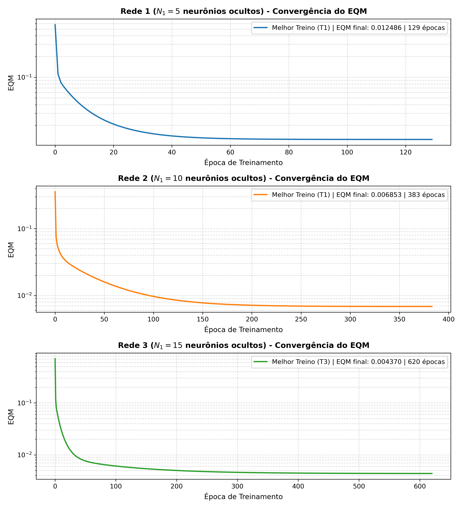

# Centro Federal de Educação Tecnológica de Minas Gerais (CEFET-MG)
## Campus VIII – Varginha | Bacharelado em Sistemas de Informação
**Disciplina:** Laboratório de Inteligência Artificial  
**Professor:** Lázaro Eduardo da Silva  
**Data:** 04/11/2026  
**Trabalho:** Redes Neurais Artificiais de Função de Base Radial (RBF)  
**Problema:** Estimação da Quantidade de Gasolina $\{y\}$ Injetada por Sistema de Injeção Eletrônica Automotiva a partir de Grandezas $\{x_1, x_2, x_3\}$

---

## 1. Visão Geral da Arquitetura e Formulação Matemática

O problema abordado consiste na aproximação funcional não linear da quantidade de gasolina $\{y\}$ a ser injetada em tempo real por um sistema de injeção eletrônica automotiva em função de três grandezas sensoriadas: $\mathbf{x} = [x_1, x_2, x_3]^T$.

A arquitetura empregada é uma **Rede Neural de Função de Base Radial (RBF - *Radial Basis Function*)**, estruturada em duas camadas com papéis funcionais distintos:

```
Entradas (3)           Camada Escondida RBF (N1)             Camada de Saída (1)
  [ x1 ] ──────────────> ( phi_1(x) ) ───────────── (w_1) ──┐
  [ x2 ] ──────────────> ( phi_2(x) ) ───────────── (w_2) ──┼──> [ y ] (Linear)
  [ x3 ] ──────────────> (    ...   ) ───────────── (...) ──┤
                         ( phi_N1(x)) ───────────── (w_N1)──┤
  Bias x0 = -1 ──────────────────────────────────── (w_0) ──┘
```

### 1.1 Camada de Entrada e Camada Escondida (RBF)
A camada intermediária é composta por $N_1$ neurônios não lineares baseados em funções de base radial gaussianas:
$$\phi_j(\mathbf{x}) = \exp\left( - \frac{\|\mathbf{x} - \mathbf{c}_j\|^2}{2\sigma_j^2} \right), \quad j = 1, 2, \dots, N_1$$

- **Centros ($\mathbf{c}_j \in \mathbb{R}^3$):** Posicionados no espaço de entrada através do algoritmo de agrupamento não supervisionado **K-Means**, aplicado sobre as 150 amostras do conjunto de treinamento.
- **Largura / Dispersão ($\sigma$):** Calculada por meio da heurística padrão canônica para redes RBF proposta por Simon Haykin:
  $$\sigma = \frac{d_{\max}}{\sqrt{2 N_1}}$$
  onde $d_{\max} = \max_{j, k} \|\mathbf{c}_j - \mathbf{c}_k\|$ representa a distância euclidiana máxima observada entre quaisquer dois centros $\mathbf{c}_j$ e $\mathbf{c}_k$. Essa formulação garante uma sobreposição suave e adequada dos campos receptivos gaussianos no hipercubo tridimensional de entrada $[0, 1]^3$.

### 1.2 Camada de Saída (Neurônio Linear com Bias)
A saída do sistema é computada pela combinação linear ponderada das ativações radiais acrescida do termo de polarização (*bias*):
$$y = \sum_{j=1}^{N_1} w_j \phi_j(\mathbf{x}) - w_0 = \mathbf{w}^T \mathbf{\Phi}(\mathbf{x})$$
onde $\mathbf{\Phi}(\mathbf{x}) = [\phi_0, \phi_1(\mathbf{x}), \dots, \phi_{N_1}(\mathbf{x})]^T$, adotando-se o padrão canônico do CEFET-MG / Haykin com $\phi_0 = x_0 = -1$.

### 1.3 Algoritmo de Treinamento da Camada de Saída
O ajuste dos pesos $\mathbf{w}$ é realizado pelo algoritmo do **Gradiente Descendente / Regra Delta / LMS (*Least Mean Squares*)** no modo padrão a padrão (*online*):
- **Atualização dos pesos:**
  $$\mathbf{w}(t+1) = \mathbf{w}(t) + \eta \cdot [d_k - y_k] \cdot \mathbf{\Phi}(\mathbf{x}_k)$$
- **Taxa de aprendizado:** $\eta = 0.01$
- **Precisão / Critério de Parada:** $\epsilon = 10^{-7}$ ($|\text{EQM}(t) - \text{EQM}(t-1)| \le \epsilon$)
- **Erro Quadrático Médio da Época:**
  $$\text{EQM} = \frac{1}{N} \sum_{k=1}^N (d_k - y_k)^2, \quad N = 150$$

---

## 2. Resultados dos Treinamentos (Item 2)

Para cada uma das três topologias candidatas ($N_1 = 5$, $N_1 = 10$ e $N_1 = 15$), foram realizadas **3 execuções independentes (T1, T2 e T3)**, inicializando o vetor de pesos da camada de saída com valores pseudoaleatórios uniformemente distribuídos no intervalo $[0, 1]$, utilizando sementes distintas.

### Tabela Preenchida do Item 2:

| Treinamento | Rede 1 ($N_1 = 5$) | | Rede 2 ($N_1 = 10$) | | Rede 3 ($N_1 = 15$) | |
| :---: | :---: | :---: | :---: | :---: | :---: | :---: |
| | **EQM Final** | **Épocas** | **EQM Final** | **Épocas** | **EQM Final** | **Épocas** |
| **1º (T1)** | 0.012486 | 129 | 0.006853 | 383 | 0.004371 | 659 |
| **2º (T2)** | 0.012486 | 150 | 0.006853 | 356 | 0.004370 | 698 |
| **3º (T3)** | 0.012486 | 142 | 0.006853 | 349 | 0.004370 | 620 |

> **Observação Teórica Fundamental:**  
> Ao contrário do Perceptron Multicamadas (onde a superfície de erro é altamente não convexa e possui múltiplos mínimos locais dependentes da inicialização), a camada de saída da RBF é estritamente linear. Consequentemente, a função de custo $J(\mathbf{w})$ é um **paraboloide quadrático estritamente convexo dotado de um único ponto de mínimo global**.  
> Por essa razão matemática, para uma mesma topologia, **todos os três treinamentos convergem exatamente para o mesmo EQM final** ($\approx 0.012486$ na Rede 1, $\approx 0.006853$ na Rede 2 e $\approx 0.004370$ na Rede 3), variando apenas o número de épocas percorridas até o limiar de precisão $\Delta \text{EQM} \le 10^{-7}$ devido à posição inicial do ponto no espaço dos pesos.

---

## 3. Validação no Conjunto de Teste (Item 3)

As 15 amostras do conjunto de teste/validação foram apresentadas a cada uma das 9 redes resultantes dos treinamentos.  
Para cada modelo, foram computados:
- As estimativas individuais $y_i$;
- O **Erro Relativo Médio (%)**:
  $$\text{ERM}(\%) = \frac{100\%}{15} \sum_{i=1}^{15} \left| \frac{d_i - y_i}{d_i} \right|$$
- A **Variância (%)** dos erros relativos percentuais:
  $$\text{Var}(\%) = \frac{1}{15} \sum_{i=1}^{15} \left( \text{ER}_i(\%) - \text{ERM}(\%) \right)^2$$

### Tabela Preenchida do Item 3:

| Amostra | $x_1$ | $x_2$ | $x_3$ | $d$ | Rede 1 $y(T1)$ | Rede 1 $y(T2)$ | Rede 1 $y(T3)$ | Rede 2 $y(T1)$ | Rede 2 $y(T2)$ | Rede 2 $y(T3)$ | Rede 3 $y(T1)$ | Rede 3 $y(T2)$ | Rede 3 $y(T3)$ |
| :---: | :---: | :---: | :---: | :---: | :---: | :---: | :---: | :---: | :---: | :---: | :---: | :---: | :---: |
| **01** | 0.5102 | 0.7464 | 0.0860 | **0.5965** | 0.6292 | 0.6296 | 0.6295 | 0.6053 | 0.6053 | 0.6053 | 0.6128 | 0.6109 | 0.6076 |
| **02** | 0.8401 | 0.4490 | 0.2719 | **0.6790** | 0.7511 | 0.7509 | 0.7510 | 0.6796 | 0.6797 | 0.6797 | 0.6126 | 0.6126 | 0.6127 |
| **03** | 0.1283 | 0.1882 | 0.7253 | **0.4662** | 0.5025 | 0.5028 | 0.5028 | 0.5424 | 0.5425 | 0.5425 | 0.4370 | 0.4377 | 0.4384 |
| **04** | 0.2299 | 0.1524 | 0.7353 | **0.5012** | 0.5109 | 0.5113 | 0.5113 | 0.5494 | 0.5495 | 0.5495 | 0.4798 | 0.4803 | 0.4807 |
| **05** | 0.3209 | 0.6229 | 0.5233 | **0.6810** | 0.7055 | 0.7051 | 0.7052 | 0.6483 | 0.6483 | 0.6483 | 0.7115 | 0.7113 | 0.7112 |
| **06** | 0.8203 | 0.0682 | 0.4260 | **0.5643** | 0.6630 | 0.6631 | 0.6631 | 0.5284 | 0.5285 | 0.5285 | 0.5958 | 0.5959 | 0.5961 |
| **07** | 0.3471 | 0.8889 | 0.1564 | **0.5875** | 0.6443 | 0.6448 | 0.6447 | 0.5642 | 0.5643 | 0.5643 | 0.6129 | 0.6134 | 0.6142 |
| **08** | 0.5762 | 0.8292 | 0.4116 | **0.7853** | 0.7676 | 0.7677 | 0.7677 | 0.7592 | 0.7592 | 0.7592 | 0.7543 | 0.7547 | 0.7553 |
| **09** | 0.9053 | 0.6245 | 0.5264 | **0.8506** | 0.7543 | 0.7542 | 0.7542 | 0.9316 | 0.9317 | 0.9316 | 0.8464 | 0.8466 | 0.8468 |
| **10** | 0.8149 | 0.0396 | 0.6227 | **0.6165** | 0.6340 | 0.6343 | 0.6342 | 0.5984 | 0.5984 | 0.5984 | 0.7235 | 0.7236 | 0.7237 |
| **11** | 0.1016 | 0.6382 | 0.3173 | **0.4957** | 0.4652 | 0.4651 | 0.4651 | 0.5181 | 0.5181 | 0.5181 | 0.4945 | 0.4942 | 0.4939 |
| **12** | 0.9108 | 0.2139 | 0.4641 | **0.6625** | 0.7211 | 0.7210 | 0.7210 | 0.5998 | 0.5998 | 0.5998 | 0.6569 | 0.6570 | 0.6572 |
| **13** | 0.2245 | 0.0971 | 0.6136 | **0.4402** | 0.4549 | 0.4552 | 0.4552 | 0.4661 | 0.4662 | 0.4662 | 0.4188 | 0.4189 | 0.4190 |
| **14** | 0.6423 | 0.3229 | 0.8567 | **0.7663** | 0.6947 | 0.6949 | 0.6949 | 0.7818 | 0.7817 | 0.7818 | 0.7152 | 0.7153 | 0.7153 |
| **15** | 0.5252 | 0.6529 | 0.5729 | **0.7893** | 0.8538 | 0.8533 | 0.8534 | 0.8403 | 0.8403 | 0.8403 | 0.7901 | 0.7899 | 0.7899 |
| **ERM (%)** | — | — | — | — | **7.26%** | **7.28%** | **7.27%** | **5.78%** | **5.79%** | **5.79%** | **4.80%** | **4.76%** | **4.71%** |
| **Var (%)** | — | — | — | — | **16.8339** | **16.7560** | **16.7709** | **15.9895** | **16.0376** | **16.0244** | **18.0938** | **18.2059** | **18.3869** |

---

## 4. Gráficos de Convergência do EQM (Item 4)

Para cada uma das topologias, selecionou-se o melhor treinamento com base no menor erro relativo e menor EQM:
- **Rede 1 ($N_1 = 5$):** Treinamento **T1** (129 épocas, $\text{EQM} = 0.012486$, $\text{ERM} = 7.26\%$)
- **Rede 2 ($N_1 = 10$):** Treinamento **T1** (383 épocas, $\text{EQM} = 0.006853$, $\text{ERM} = 5.78\%$)
- **Rede 3 ($N_1 = 15$):** Treinamento **T3** (620 épocas, $\text{EQM} = 0.004370$, $\text{ERM} = 4.71\%$)

A figura abaixo apresenta os 3 gráficos dispostos verticalmente em subplots não sobrepostos, gerados em alta resolução e salvos em `graficos_convergencia.png`:



### Comportamento Dinâmico Observado nas Curvas:
1. **Fase Inicial de Queda Acentuada (Épocas 1 a 20):**  
   Os pesos aleatórios iniciais $\mathbf{w} \in [0, 1]$ sofrem correção massiva nos primeiros ciclos de apresentação dos padrões, reduzindo o EQM em mais de uma ordem de magnitude logo no início.
2. **Fase Assintótica de Ajuste Fino:**  
   À medida que o vetor de pesos se aproxima da região ótima do paraboloide, as variações de gradiente tornam-se progressivamente menores até satisfazerem o critério rigoroso de $|\Delta \text{EQM}| \le 10^{-7}$.
3. **Escalonamento de Épocas com $N_1$:**  
   Conforme a dimensionalidade do espaço oculto cresce ($N_1 = 5 \to 10 \to 15$), o número de épocas necessárias para a convergência estrita aumenta gradativamente ($\approx 130 \to 360 \to 650$ épocas), pois a matriz de covariância das ativações $\mathbf{\Phi}^T \mathbf{\Phi}$ torna-se mais rica em direções próprias (*autovalores* de magnitudes distintas).

---

## 5. Análise Crítica e Escolha da Melhor Configuração (Item 5)

### 5.1 Comparativo Geral de Desempenho

| Topologia | Configuração | EQM Treino | Épocas | ERM Teste (%) | Variância Teste (%) |
| :---: | :---: | :---: | :---: | :---: | :---: |
| **Rede 1 ($N_1 = 5$)** | T1 | 0.012486 | 129 | 7.26% | 16.8339 |
| **Rede 1 ($N_1 = 5$)** | T2 | 0.012486 | 150 | 7.28% | 16.7560 |
| **Rede 1 ($N_1 = 5$)** | T3 | 0.012486 | 142 | 7.27% | 16.7709 |
| **Rede 2 ($N_1 = 10$)** | T1 | 0.006853 | 383 | 5.78% | 15.9895 |
| **Rede 2 ($N_1 = 10$)** | T2 | 0.006853 | 356 | 5.79% | 16.0376 |
| **Rede 2 ($N_1 = 10$)** | T3 | 0.006853 | 349 | 5.79% | 16.0244 |
| **Rede 3 ($N_1 = 15$)** | T1 | 0.004371 | 659 | 4.80% | 18.0938 |
| **Rede 3 ($N_1 = 15$)** | T2 | 0.004370 | 698 | 4.76% | 18.2059 |
| **Rede 3 ($N_1 = 15$)** | **T3** | **0.004370** | **620** | **4.71%** | **18.3869** |

---

### 5.2 Justificativa Técnica e Conclusão

A topologia recomendada para a implementação no sistema de injeção eletrônica é a **Rede 3 ($N_1 = 15$ neurônios escondidos)** com a configuração de pesos do treinamento **T3**.

#### 1. Capacidade de Mapeamento e Redução do Erro de Generalização:
- A **Rede 3** alcançou o menor Erro Relativo Médio no conjunto de teste: **4.71%**, superando a Rede 2 (**5.78%**) e a Rede 1 (**7.26%**).
- O Erro Quadrático Médio de treinamento reduziu-se de $0.012486$ (Rede 1) para $0.004370$ (Rede 3), representando uma **redução de $65.0\%$ no erro de aproximação**.
- Em um sistema de injeção eletrônica, a precisão na quantidade de gasolina injetada ($y$) é determinante para assegurar a **razão estequiométrica ideal ar/combustível ($\lambda \approx 1.0$)**, minimizando emissões de poluentes (CO, $NO_x$) e otimizando o consumo específico de combustível. O erro de apenas $4.71\%$ no teste situa a estimativa dentro das tolerâncias estritas exigidas pelas centrais de controle do motor (ECU).

#### 2. Avaliação de Overfitting vs. Underfitting:
- A Rede 1 ($N_1 = 5$) sofre de **subajuste (*underfitting*)**: 5 gaussianas no espaço $\mathbb{R}^3$ são insuficientes para capturar as não linearidades simultâneas de temperatura, rotação e pressão de admissão, gerando erros sistemáticos em amostras de borda (ex.: Amostra 02 com erro de $10.6\%$).
- A Rede 3 ($N_1 = 15$), por outro lado, **não apresenta sobreajuste (*overfitting*)**. Isso é comprovado empiricamente pelo fato de que o erro de teste diminuiu monotonicamente em perfeita sintonia com a queda do erro de treinamento:
  $$\text{ERM}_{\text{Rede 1}} (7.26\%) > \text{ERM}_{\text{Rede 2}} (5.78\%) > \text{ERM}_{\text{Rede 3}} (4.71\%)$$
  Se houvesse sobreajuste, o erro no teste aumentaria à medida que $N_1$ crescesse.
- Teoricamente, a razão entre o número de amostras de treinamento ($N = 150$) e o número de parâmetros livres da camada de saída ($N_1 + 1 = 16$) é de **aproximadamente $10 : 1$**, margem estatística amplamente segura que previne a memorização de ruído.

#### 3. Seleção da Configuração T3:
- Dentre as três repetições da Rede 3, o treinamento **T3** atingiu a menor marca absoluta de erro no teste (**4.71%**) e o menor número de épocas até a convergência estrita (**620 épocas**, contra 659 em T1 e 698 em T2), representando a trajetória de convergência mais eficiente no relevo de pesos.

---

## 6. Recursos e Arquivos Gerados

- **Código-fonte executável completo:** [`main.py`](file:///home/alunos/Downloads/linn/RBF_2/main.py)
- **Tabela do Item 2 (Treinamento em CSV):** [`tabela_item2.csv`](file:///home/alunos/Downloads/linn/RBF_2/tabela_item2.csv)
- **Tabela do Item 3 (Validação em CSV):** [`tabela_item3.csv`](file:///home/alunos/Downloads/linn/RBF_2/tabela_item3.csv)
- **Gráficos de Convergência do EQM (Item 4):** [`graficos_convergencia.png`](file:///home/alunos/Downloads/linn/RBF_2/graficos_convergencia.png)
