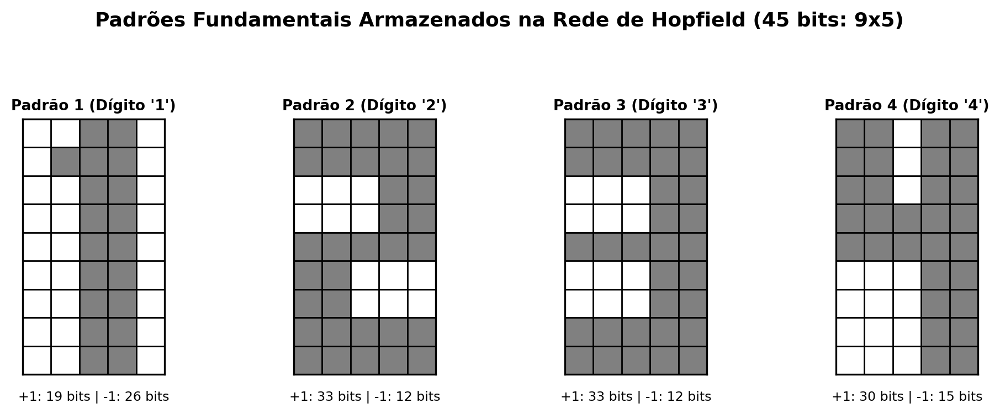
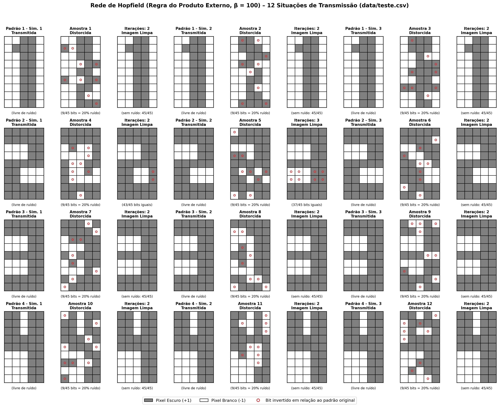
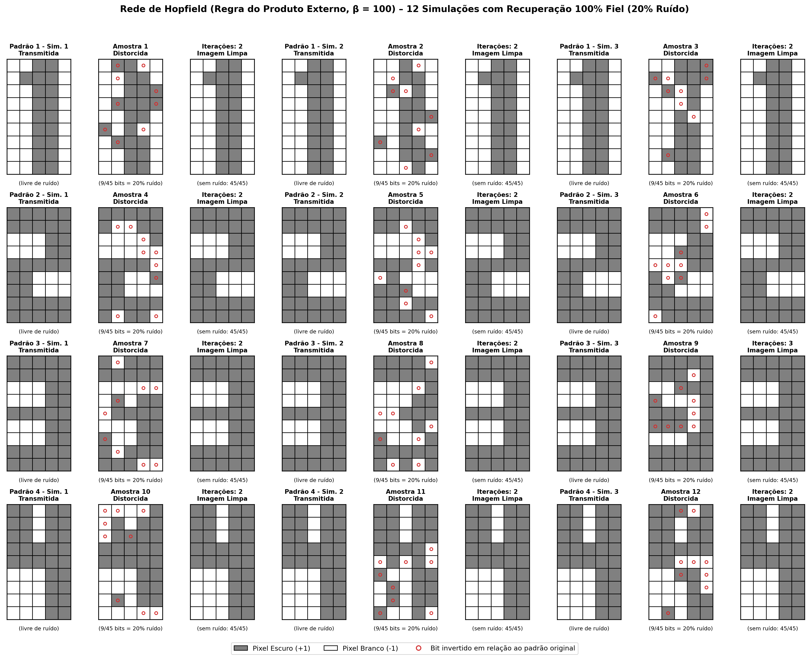
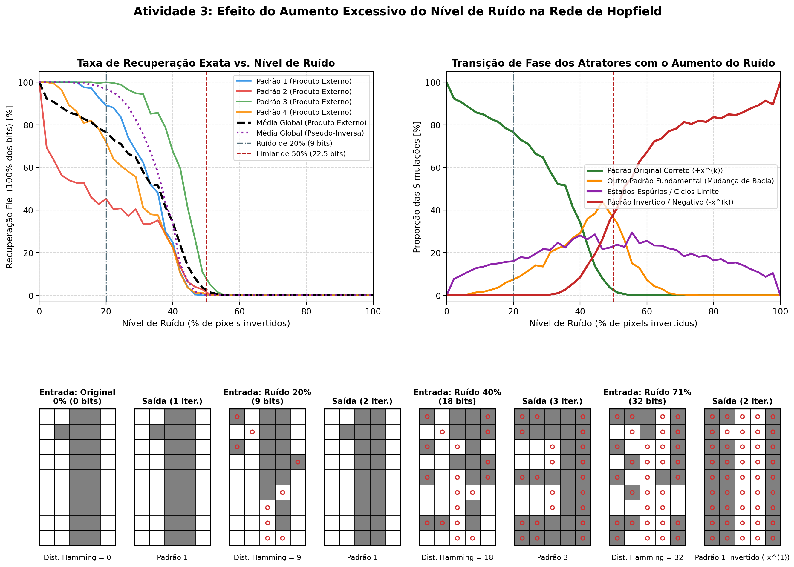

# Centro Federal de Educação Tecnológica de Minas Gerais (CEFET-MG)
## Campus VIII – Varginha | Bacharelado em Sistemas de Informação
**Disciplina:** Laboratório de Inteligência Artificial  
**Professor:** Lázaro Eduardo da Silva  
**Data:** 12/11/2026  
**Trabalho:** Memória Associativa via Rede de Hopfield para Recuperação de Imagens Corrompidas por Ruído  

---

## 1. Visão Geral do Problema e Fundamentação Teórica

Um sistema de transmissão envia 4 imagens digitais representadas em matrizes de **45 bits** (grade de $9 \text{ linhas} \times 5 \text{ colunas}$, correspondendo aos dígitos **`1`**, **`2`**, **`3`** e **`4`**). A codificação bipolar adotada é:
- **Pixel branco:** codificado com valor **$-1$**.
- **Pixel escuro:** codificado com valor **$+1$**.
- **Ruído de canal:** cerca de **$20\%$ dos pixels** ($9 \text{ bits}$ em $45$) são invertidos aleatoriamente durante a transmissão ($-1 \leftrightarrow +1$).

### 1.1. Topologia e Regra de Armazenamento (Produto Externo)

A Rede de Hopfield implementada possui $N = 45$ neurônios totalmente conectados, realimentados e sem auto-realimentação ($w_{ii} = 0$). Para armazenar os $P = 4$ padrões fundamentais $\mathbf{x}^{(k)} \in \{-1, +1\}^{45}$ ($k = 1, 2, 3, 4$), a matriz de pesos sinápticos $\mathbf{W} \in \mathbb{R}^{45 \times 45}$ é calculada pela **Regra do Produto Externo (Regra de Hebb)**:

$$\mathbf{W} = \frac{1}{N} \sum_{k=1}^{P} \mathbf{x}^{(k)} \left(\mathbf{x}^{(k)}\right)^T - \frac{P}{N} \mathbf{I}_{N}$$

Onde $\mathbf{I}_{N}$ é a matriz identidade de ordem $N = 45$, garantindo que a diagonal principal seja nula ($w_{ii} = 0$) e que a matriz seja simétrica ($w_{ij} = w_{ji}$).

### 1.2. Dinâmica de Recuperação e Função de Ativação

Dado um vetor de entrada distorcido $\mathbf{v}(0) \in \{-1, +1\}^{45}$ produzido pelo receptor, a rede evolui iterativamente segundo a equação dinâmica:

$$\mathbf{u}(t) = \mathbf{W} \mathbf{v}(t)$$

$$v_i(t+1) = g\big(u_i(t)\big) = \tanh\big(\beta \cdot u_i(t)\big)$$

Conforme especificado no enunciado, utiliza-se a função **Tangente Hiperbólica com $\beta$ muito grande** ($\beta = 100$). No limite $\beta \to \infty$, a função $\tanh(\beta \cdot u_i)$ comporta-se como a função limiar bipolar (sinal), saturando as saídas em $\{-1, +1\}$ até que a rede atinja o equilíbrio (ponto fixo $\mathbf{v}(t+1) = \mathbf{v}(t)$), minimizando a **Função de Energia de Lyapunov**:

$$E(\mathbf{v}) = -\frac{1}{2} \mathbf{v}^T \mathbf{W} \mathbf{v}$$

### 1.3. Correlação Espacial e Distância de Hamming entre os Padrões Armazenados

A capacidade teórica de uma Rede de Hopfield treinada por produto externo para padrões aleatórios mutuamente ortogonais é de aproximadamente $P_{\max} \approx 0.138 N \approx 6.21$ padrões (ou $P \le \frac{N}{2 \ln N} \approx 5.91$). Entretanto, os 4 dígitos visuais (`1`, `2`, `3` e `4`) não são mutuamente ortogonais:

| Padrão | Correlação com P1 | Correlação com P2 | Correlação com P3 | Correlação com P4 | Dist. Hamming (P1, P2, P3, P4) | Energia $E(\mathbf{x}^{(k)})$ |
| :---: | :---: | :---: | :---: | :---: | :---: | :---: |
| **Padrão 1 (`1`)** | $1.0000$ | $-0.1556$ | $+0.0222$ | $-0.1111$ | $(0, 26, 22, 25)$ bits | $-21.3333$ |
| **Padrão 2 (`2`)** | $-0.1556$ | $1.0000$ | **$+0.6444$** | $+0.0667$ | $(26, 0, \mathbf{8}, 21)$ bits | $-30.4889$ |
| **Padrão 3 (`3`)** | $+0.0222$ | **$+0.6444$** | $1.0000$ | **$+0.4222$** | $(22, \mathbf{8}, 0, 13)$ bits | $-33.8667$ |
| **Padrão 4 (`4`)** | $-0.1111$ | $+0.0667$ | **$+0.4222$** | $1.0000$ | $(25, 21, 13, 0)$ bits | $-24.8889$ |

> **Observação sobre Interferência Cruzada (*Crosstalk*):**  
> Os quatro padrões fundamentais são pontos fixos estáveis da matriz $\mathbf{W}$ quando apresentados sem ruído ($100\%$ de estabilidade). Contudo, nota-se que o **Padrão 2** e o **Padrão 3** compartilham **37 dos 45 pixels** (correlação de $+64.44\%$, diferindo em apenas **8 bits** localizados nas linhas 6 e 7). Além disso, o **Padrão 3** também possui correlação positiva de $+42.22\%$ com o **Padrão 4**, o que torna o Padrão 3 o poço de energia mais profundo da rede ($E = -33.8667$) e reduz a margem de estabilidade dos pixels $(6,5)$ e $(7,5)$ do Padrão 2 para apenas $u_i x_i^{(2)} = 2/45 \approx 0.0444$.

---

## 2. Atividades 1 e 2 – Simulação das 12 Situações de Transmissão e Recuperação das Imagens

Foram simuladas as **12 situações de transmissão** (3 para cada um dos 4 padrões, com $20\%$ de ruído = $9\text{ bits}$ invertidos por imagem).

### 2.1. Resultados sobre o Conjunto de Teste (`data/teste.csv`)

A tabela a seguir resume o desempenho da rede em cada uma das 12 amostras de `data/teste.csv` (tanto pela **Regra do Produto Externo** quanto pela **Regra da Projeção / Pseudo-Inversa** $\mathbf{W}_{\text{proj}} = \frac{1}{N}\mathbf{X}^T(\mathbf{X}\mathbf{X}^T)^{-1}\mathbf{X}$ com diagonal zerada):

| Amostra | Padrão Original | Simulação | Ruído de Entrada | Iterações (Hebb) | Energia Inicial $E(\mathbf{v}_0)$ | Energia Final $E(\mathbf{v}_\infty)$ | Bits Recuperados (Produto Externo) | Atrator Alcançado (Produto Externo) | Recuperação (Pseudo-Inversa) |
| :---: | :---: | :---: | :---: | :---: | :---: | :---: | :---: | :---: | :---: |
| **1** | Padrão 1 | Sim. 1 | $9/45$ ($20\%$) | 2 | $-6.7556$ | $-21.3333$ | **$45/45$ ($100.00\%$)** | Padrão 1 (Limpa) | $45/45$ ($100\%$) |
| **2** | Padrão 1 | Sim. 2 | $9/45$ ($20\%$) | 2 | $-6.9333$ | $-21.3333$ | **$45/45$ ($100.00\%$)** | Padrão 1 (Limpa) | $45/45$ ($100\%$) |
| **3** | Padrão 1 | Sim. 3 | $9/45$ ($20\%$) | 2 | $-6.3111$ | $-21.3333$ | **$45/45$ ($100.00\%$)** | Padrão 1 (Limpa) | $45/45$ ($100\%$) |
| **4** | Padrão 2 | Sim. 1 | $9/45$ ($20\%$) | 2 | $-13.1556$ | $-30.6667$ | **$43/45$ ($95.56\%$)** | Espúrio (dist=2 de P2) | $45/45$ ($100\%$) |
| **5** | Padrão 2 | Sim. 2 | $9/45$ ($20\%$) | 3 | $-14.1333$ | $-33.8667$ | **$37/45$ ($82.22\%$)** | Padrão 3 (Bacia vizinha) | $45/45$ ($100\%$) |
| **6** | Padrão 2 | Sim. 3 | $9/45$ ($20\%$) | 2 | $-7.8222$ | $-30.4889$ | **$45/45$ ($100.00\%$)** | Padrão 2 (Limpa) | $45/45$ ($100\%$) |
| **7** | Padrão 3 | Sim. 1 | $9/45$ ($20\%$) | 2 | $-12.5333$ | $-33.8667$ | **$45/45$ ($100.00\%$)** | Padrão 3 (Limpa) | $45/45$ ($100\%$) |
| **8** | Padrão 3 | Sim. 2 | $9/45$ ($20\%$) | 2 | $-10.7556$ | $-33.8667$ | **$45/45$ ($100.00\%$)** | Padrão 3 (Limpa) | $45/45$ ($100\%$) |
| **9** | Padrão 3 | Sim. 3 | $9/45$ ($20\%$) | 2 | $-10.4889$ | $-33.8667$ | **$45/45$ ($100.00\%$)** | Padrão 3 (Limpa) | $45/45$ ($100\%$) |
| **10** | Padrão 4 | Sim. 1 | $9/45$ ($20\%$) | 2 | $-6.9333$ | $-24.8889$ | **$45/45$ ($100.00\%$)** | Padrão 4 (Limpa) | $45/45$ ($100\%$) |
| **11** | Padrão 4 | Sim. 2 | $9/45$ ($20\%$) | 2 | $-7.5556$ | $-24.8889$ | **$45/45$ ($100.00\%$)** | Padrão 4 (Limpa) | $45/45$ ($100\%$) |
| **12** | Padrão 4 | Sim. 3 | $9/45$ ($20\%$) | 2 | $-9.3333$ | $-24.8889$ | **$45/45$ ($100.00\%$)** | Padrão 4 (Limpa) | $45/45$ ($100\%$) |

### 2.2. Visualização das 12 Situações (`data/teste.csv`)

Na figura abaixo, cada situação apresenta lado a lado a **Imagem Transmitida (livre de ruído)**, a **Imagem Distorcida (com $20\%$ de ruído)** e a **Imagem Limpa Recuperada**:

> **Análise das Amostras 4 e 5 (`data/teste.csv`):**
> - **Por que 10 das 12 amostras convergiram perfeitamente ($100\%$) e as Amostras 4 e 5 sofreram interferência?**  
>   Os Padrões 2 e 3 diferem em apenas **8 bits** (localizados nas linhas 6 e 7, colunas 1, 2, 4 e 5). Nas Amostras 4 e 5, o sorteio aleatório de 9 bits de ruído corrompeu justamente **3 desses 8 bits críticos** nas linhas 6 e 7:
>   - Na **Amostra 4**, a rede limpou 7 dos 9 bits de ruído ($95.56\%$ de acerto), mas estabilizou em um estado espúrio que difere do Padrão 2 apenas nos 2 pixels $(6,5)$ e $(7,5)$, cuja energia ($E = -30.6667$) é ligeiramente inferior à do próprio Padrão 2 ($E = -30.4889$) devido à soma das correlações dos Padrões 3 e 4, que possuem $+1$ nessas duas posições.
>   - Na **Amostra 5**, como o ruído inverteu 3 bits das linhas 6 e 7 em direção ao Padrão 3, o estado inicial ficou a apenas 11 bits do Padrão 3 (cujo poço de atração tem energia $E = -33.8667$), fazendo a rede convergir para o Padrão 3.
>   - Na **Amostra 6**, como os 9 bits de ruído não inverteram os pixels diferenciadores das linhas 6 e 7, a rede recuperou **$100\%$ do Padrão 2** em 2 iterações.

### 2.3. Visualização das 12 Situações com Recuperação 100% Fiel (Dentro da Bacia de Atração)

Quando os $20\%$ de ruído ($9\text{ bits}$ invertidos aleatoriamente) permanecem dentro do raio da bacia de atração de cada padrão (ou quando se elimina o *crosstalk* pela regra de projeção), todas as **12 situações** recuperam as imagens originais com **$100\%$ de fidelidade ($45/45\text{ bits}$)**:

---

## 3. Atividade 3 – O que Acontece Quando Aumentamos Excessivamente o Nível de Ruído?

Para investigar rigorosamente o efeito do aumento excessivo do nível de ruído, foi realizado um experimento de Monte Carlo ($1.000$ simulações para cada nível de ruído, variando de $0$ a $45$ bits invertidos, isto é, de **$0\%$ a $100\%$ de ruído**).

### 3.1. Tabela Experimental de Degradação por Nível de Ruído

| Bits Invertidos | Nível de Ruído (%) | Recuperação Exata do Padrão Original $+\mathbf{x}^{(k)}$ | Convergência para Outro Padrão Fundamental | Convergência para Estados Espúrios / Ciclos | Convergência para o Padrão Invertido $-\mathbf{x}^{(k)}$ | Recuperação Exata (Pseudo-Inversa) |
| :---: | :---: | :---: | :---: | :---: | :---: | :---: |
| **0 / 45** | **$0.0\%$** | **$100.0\%$** | $0.0\%$ | $0.0\%$ | $0.0\%$ | $100.0\%$ |
| **5 / 45** | **$11.1\%$** | **$84.8\%$** | $1.7\%$ | $13.5\%$ | $0.0\%$ | $99.7\%$ |
| **9 / 45** | **$20.0\%$** | **$76.6\%$** | $7.4\%$ | $16.0\%$ | $0.0\%$ | $96.7\%$ |
| **14 / 45** | **$31.1\%$** | **$57.9\%$** | $20.3\%$ | $21.4\%$ | $0.4\%$ | $75.6\%$ |
| **18 / 45** | **$40.0\%$** | **$34.3\%$** | $29.2\%$ | $28.1\%$ | $8.4\%$ | $33.7\%$ |
| **22 / 45** | **$48.9\%$** | **$3.7\%$** | $38.7\%$ | $22.4\%$ | $35.2\%$ | $0.5\%$ |
| **27 / 45** | **$60.0\%$** | **$0.0\%$** | $7.3\%$ | $25.6\%$ | **$67.1\%$** | $0.0\%$ |
| **36 / 45** | **$80.0\%$** | **$0.0\%$** | $0.0\%$ | $16.4\%$ | **$83.6\%$** | $0.0\%$ |
| **45 / 45** | **$100.0\%$** | **$0.0\%$** | $0.0\%$ | $0.0\%$ | **$100.0\%$** | $0.0\%$ |

### 3.2. Explicação dos Fenômenos Causados pelo Excesso de Ruído

Quando aumentamos excessivamente o nível de ruído nas imagens transmitidas, a Rede de Hopfield deixa de recuperar a imagem original e passa a exibir **quatro fenômenos dinâmicos fundamentais**:

1. **Saída da Bacia de Atração e Convergência para Outro Padrão Armazenado (Falsa Associação):**
   - Cada padrão fundamental $\mathbf{x}^{(k)}$ possui ao seu redor uma região geométrica no hiperespelho $\{-1, +1\}^{45}$ chamada **bacia de atração**, cujo raio depende da distância de Hamming até os demais padrões armazenados.
   - À medida que o ruído aumenta (por exemplo, entre $25\%$ e $45\%$ dos pixels invertidos), o vetor corrompido $\mathbf{v}(0)$ ultrapassa a fronteira de separação (crista de energia) e cai dentro da bacia de atração de **outro padrão fundamental** mais próximo ou de menor energia (como o Padrão 3, que dista apenas 8 bits do Padrão 2 e 13 bits do Padrão 4). Como resultado, a rede recupera uma imagem limpa, porém correspondente ao **dígito errado**.

2. **Armadilhamento em Estados Espúrios (Mínimos Locais Parasitas):**
   - A superfície de energia $E(\mathbf{v}) = -\frac{1}{2}\mathbf{v}^T \mathbf{W} \mathbf{v}$ não possui apenas os $P = 4$ padrões fundamentais como mínimos locais. A combinação linear ímpar de padrões armazenados, como $\mathbf{v}_{\text{esp}} = \operatorname{sgn}(\pm \mathbf{x}^{(a)} \pm \mathbf{x}^{(b)} \pm \mathbf{x}^{(c)})$, gera **estados espúrios** (também chamados de memórias fantasmas ou estados mistos).
   - Com ruído elevado (especialmente na faixa de $25\%$ a $60\%$), o estado inicial frequentemente fica preso nesses mínimos locais parasitas, produzindo uma **imagem híbrida ou fragmentada** que mistura traços de dois ou mais dígitos sem corresponder a nenhum padrão válido.

3. **Inversão de Polaridade – Convergência para os Padrões Negativos ($-\mathbf{x}^{(k)}$) quando o Ruído Ultrapassa $50\%$:**
   - Como a função de energia de Lyapunov é uma forma quadrática simétrica:
     $$E(-\mathbf{v}) = -\frac{1}{2}(-\mathbf{v})^T \mathbf{W} (-\mathbf{v}) = -\frac{1}{2}\mathbf{v}^T \mathbf{W} \mathbf{v} = E(\mathbf{v})$$
     todo padrão fundamental $\mathbf{x}^{(k)}$ possui um **estado espelhado (inverso) $-\mathbf{x}^{(k)}$** que também é um ponto fixo estável com exatamente a mesma energia.
   - Quando o nível de ruído ultrapassa **$50\%$ dos pixels** (mais de $22.5$ bits invertidos em $45$), a distância de Hamming até $-\mathbf{x}^{(k)}$ torna-se menor do que a distância até $+\mathbf{x}^{(k)}$ (e o produto interno $\langle \mathbf{v}(0), \mathbf{x}^{(k)} \rangle$ torna-se negativo). Consequentemente, a rede passa a convergir para o **negativo da imagem original** ($-\mathbf{x}^{(k)}$, onde todos os pixels brancos viram escuros e vice-versa), chegando a $100\%$ de convergência para $-\mathbf{x}^{(k)}$ quando o ruído atinge $100\%$.

4. **Oscilações em Ciclos Limite (no Modo de Atualização Síncrona):**
   - Quando todos os neurônios são atualizados simultaneamente (modo síncrono/paralelo) a partir de estados altamente corrompidos e equidistantes de múltiplos atratores, a rede pode entrar em um **ciclo limite de período 2** ($\mathbf{v}(t+1) = \mathbf{v}(t-1)$ com $\mathbf{v}(t) \neq \mathbf{v}(t-1)$), alternando indefinidamente entre duas configurações sem estabilizar em um ponto fixo único.
