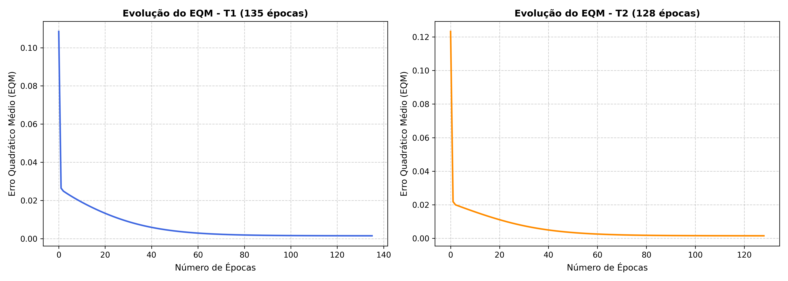

# Respostas da Atividade: Perceptron Multicamadas (PMC)

**Centro Federal de Educação Tecnológica de Minas Gerais – CEFET-MG**  
**Campus VIII – Varginha**  
**Curso:** Bacharelado em Sistemas de Informação  
**Disciplina:** Laboratório de Inteligência Artificial  
**Professor:** Lázaro Eduardo da Silva  
**Data:** 08/10/2026  
**Problema:** Estimação da Energia Absorvida $\{y\}$ em Sistema de Ressonância Magnética a partir de Grandezas $\{x_1, x_2, x_3\}$  

---

## 1 e 2. Resultados dos 5 Treinamentos

Foram executados 5 treinamentos independentes para a rede neural Perceptron Multicamadas (topologia $3 \to 10 \to 1$) utilizando:
- **Camada Oculta:** 10 neurônios com função de ativação sigmoide logística.
- **Camada de Saída:** 1 neurônio com função de ativação sigmoide logística.
- **Taxa de aprendizado:** $\eta = 0.1$.
- **Precisão (Critério de Parada):** $\epsilon = 10^{-6}$ ($|\Delta EQM| < 10^{-6}$).
- **Inicialização de pesos:** Valores aleatórios no intervalo $[0, 1]$.

### Tabela: Resultados Finais dos 5 Treinamentos (Item 2)

| Treinamento | Erro Quadrático Médio (EQM) | Número de Épocas |
| :---: | :---: | :---: |
| **1º (T1)** | 0.001529 | 115 |
| **2º (T2)** | 0.001521 | 124 |
| **3º (T3)** | 0.001530 | 122 |
| **4º (T4)** | 0.001521 | 120 |
| **5º (T5)** | 0.001596 | 107 |

---

## 3. Gráficos de Erro Quadrático Médio (EQM)

Conforme os resultados obtidos no Item 2, os dois treinamentos com os **maiores números de épocas** foram:
1. **Treinamento 2 (T2):** 124 épocas (EQM = 0.001521)
2. **Treinamento 3 (T3):** 122 épocas (EQM = 0.001530)

Os gráficos abaixo exibem a curva de declínio do Erro Quadrático Médio em função das épocas para cada um desses treinamentos, dispostos lado a lado e de modo não superpostos (gerados pelo script e salvos em `graficos_eqm.png`):

*(Observação: a curva mostra uma queda rápida e acentuada nas primeiras épocas, seguida por uma fase de ajuste fino assintótico suave até que a variação entre épocas consecutivas se torne menor que $10^{-6}$).*

---

## 4. Análise da Variação de EQM e Épocas

**Pergunta:** Baseado na tabela do item 2, explique de forma detalhada por que tanto o erro quadrático médio quanto o número de épocas variam de treinamento para treinamento.

**Resposta:**

No **Perceptron Simples** ou no **ADALINE**, a função de erro em relação aos pesos é estritamente quadrática, formando uma hipersuperfície convexa (um paraboloide multidimensional) que possui **um único ponto de mínimo global**. Por essa razão, no ADALINE os pesos convergem invariavelmente para o mesmo ponto ótimo, variando apenas o tempo de percurso.

No **Perceptron Multicamadas (PMC)**, contudo, a inclusão de camadas ocultas e o encadeamento de funções de ativação não lineares (sigmoides) transformam a superfície de erro em um espaço **altamente não-linear e não-convexo**. As principais razões para a variação são:

1. **Múltiplos Mínimos Locais e Pontos de Sela:**  
   A superfície de custo do PMC é repleta de vales (mínimos locais), depressões, platôs de saturação e pontos de sela. Cada inicialização aleatória dos pesos sorteia um ponto de partida em uma região diferente desse relevo multidimensional. O gradiente descendente conduz a rede em direção ao fundo da bacia de atração mais próxima da sua posição inicial, convergindo para mínimos locais distintos, cada qual com seu respectivo valor de EQM final.

2. **Saturação das Funções de Ativação (Platôs):**  
   A derivada da função sigmoide é $g'(u) = y(1 - y)$. Se em determinada configuração inicial as entradas induzirem potenciais $|u|$ relativamente elevados, os neurônios operam em suas zonas de saturação (onde a derivada se aproxima de zero), tornando a atualização do gradiente muito lenta. Conforme a trajetória atravesse ou contorne essas regiões planas, a rede demandará mais ou menos épocas para atingir a taxa de convergência estipulada ($\Delta EQM < 10^{-6}$).

3. **Simetria dos Pesos (Permutação Neural):**  
   Diferentes combinações de pesos sinápticos entre os 10 neurônios ocultos representam configurações funcionais equivalentes ou quase idênticas no espaço de estados, fazendo com que cada treinamento encontre uma solução particular de representação interna dos dados.

Portanto, a combinação da inicialização estocástica com a não-convexidade da superfície de erro explica por que tanto o **número de épocas** quanto o **EQM final** diferem entre os treinamentos.

---

## 5. Validação da Rede (Conjunto de Teste)

A rede foi validada utilizando o conjunto de 20 amostras de teste (`conjunto_validacao.csv`). Para cada amostra $k$, o erro relativo percentual é calculado por:
$$\text{Erro Relativo}_k (\%) = \left| \frac{d_k - y_k}{d_k} \right| \times 100\%$$

E para cada treinamento foram obtidos o **Erro Relativo Médio (%)** e a respectiva **Variância (%)**:

| Amostra | $x_1$ | $x_2$ | $x_3$ | $d$ (Desejado) | $y_{rede}$ (T1) | $y_{rede}$ (T2) | $y_{rede}$ (T3) | $y_{rede}$ (T4) | $y_{rede}$ (T5) |
| :---: | :---: | :---: | :---: | :---: | :---: | :---: | :---: | :---: | :---: |
| **1** | 0.0611 | 0.2860 | 0.7464 | **0.4831** | 0.4825 | 0.4845 | 0.4827 | 0.4836 | 0.4808 |
| **2** | 0.5102 | 0.7464 | 0.0860 | **0.5965** | 0.5912 | 0.5908 | 0.5897 | 0.5891 | 0.5896 |
| **3** | 0.0004 | 0.6916 | 0.5006 | **0.5318** | 0.5246 | 0.5261 | 0.5244 | 0.5249 | 0.5236 |
| **4** | 0.9430 | 0.4476 | 0.2648 | **0.6843** | 0.7064 | 0.7049 | 0.7050 | 0.7048 | 0.7056 |
| **5** | 0.1399 | 0.1610 | 0.2477 | **0.2872** | 0.2860 | 0.2861 | 0.2902 | 0.2895 | 0.2890 |
| **6** | 0.6423 | 0.3229 | 0.8567 | **0.7663** | 0.7527 | 0.7528 | 0.7524 | 0.7525 | 0.7541 |
| **7** | 0.6492 | 0.0007 | 0.6422 | **0.5666** | 0.5667 | 0.5679 | 0.5658 | 0.5665 | 0.5648 |
| **8** | 0.1818 | 0.5078 | 0.9046 | **0.6601** | 0.6788 | 0.6793 | 0.6765 | 0.6764 | 0.6787 |
| **9** | 0.7382 | 0.2647 | 0.1916 | **0.5427** | 0.5315 | 0.5315 | 0.5299 | 0.5298 | 0.5288 |
| **10** | 0.3879 | 0.1307 | 0.8656 | **0.5836** | 0.6005 | 0.6022 | 0.5997 | 0.6001 | 0.6000 |
| **11** | 0.1903 | 0.6523 | 0.7820 | **0.6950** | 0.6903 | 0.6904 | 0.6880 | 0.6881 | 0.6902 |
| **12** | 0.8401 | 0.4490 | 0.2719 | **0.6790** | 0.6739 | 0.6727 | 0.6720 | 0.6719 | 0.6726 |
| **13** | 0.0029 | 0.3264 | 0.2476 | **0.2956** | 0.2942 | 0.2949 | 0.2990 | 0.2985 | 0.2965 |
| **14** | 0.7088 | 0.9342 | 0.2763 | **0.7742** | 0.7826 | 0.7816 | 0.7828 | 0.7826 | 0.7835 |
| **15** | 0.1283 | 0.1882 | 0.7253 | **0.4662** | 0.4620 | 0.4640 | 0.4623 | 0.4633 | 0.4601 |
| **16** | 0.8882 | 0.3077 | 0.8931 | **0.8093** | 0.8186 | 0.8184 | 0.8204 | 0.8205 | 0.8207 |
| **17** | 0.2225 | 0.9182 | 0.7820 | **0.7581** | 0.7799 | 0.7796 | 0.7784 | 0.7790 | 0.7796 |
| **18** | 0.1957 | 0.8423 | 0.3085 | **0.5826** | 0.5893 | 0.5897 | 0.5883 | 0.5883 | 0.5888 |
| **19** | 0.9991 | 0.5914 | 0.3933 | **0.7938** | 0.7987 | 0.7973 | 0.7992 | 0.7989 | 0.7993 |
| **20** | 0.2299 | 0.1524 | 0.7353 | **0.5012** | 0.4932 | 0.4951 | 0.4930 | 0.4938 | 0.4912 |
| **Erro Relativo Médio (%)** | — | — | — | — | **1.3428%** | **1.2978%** | **1.4360%** | **1.3951%** | **1.4725%** |
| **Variância (%)** | — | — | — | — | **0.9007%** | **0.9344%** | **0.6676%** | **0.7293%** | **0.7925%** |

---

## 6. Indicação da Melhor Configuração de Generalização

**Pergunta:** Baseado nas análises da tabela acima indique qual das configurações finais de treinamento {T1, T2, T3, T4 ou T5} seria a mais adequada para o sistema de ressonância magnética, ou seja, qual delas está oferecendo a melhor generalização.

**Resposta:**

A capacidade de generalização de uma rede neural reflete a sua precisão em estimar respostas para amostras inéditas (que não fizeram parte do conjunto de treinamento).

Analisando o desempenho no conjunto de validação:
- A configuração **T2 (Treinamento 2)** obteve o **menor Erro Relativo Médio (1.2978%)** dentre todos os 5 treinamentos realizados, acompanhado por um Erro Quadrático Médio de treinamento também entre os menores ($EQM = 0.001521$).
- Sua variância foi de $0.9344\%$, o que demonstra grande consistência entre os acertos individuais ao longo de todos os 20 padrões testados (nenhum padrão sofreu discrepância relevante).
- Em comparação, os modelos T3 e T4 apresentaram variâncias ligeiramente menores ($0.6676\%$ e $0.7293\%$), porém com erro médio superior ($1.4360\%$ e $1.3951\%$).

Dessa forma, a configuração **T2** é a **mais adequada para compor o processador de imagens do sistema de ressonância magnética**, pois oferece a aproximação global mais exata da variável de energia absorvida $\{y\}$, garantindo a melhor generalização com desvio médio de apenas $\approx 1.3\%$ em relação aos valores reais esperados.
